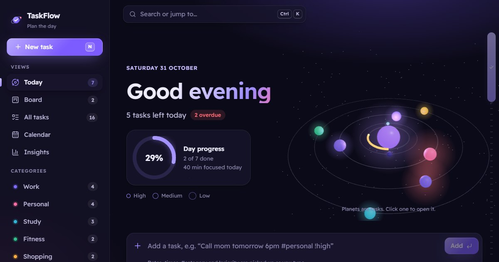

# TaskFlow

[](https://github.com/ramezGamel01/Task-Flow/actions/workflows/ci.yml)

A task manager that plans your day. Today's tasks circle a glowing core as planets in a 3D orbit, and finishing one pulls it into the centre. There's also a drag-and-drop board, a calendar, insights from the last two weeks, and quick add that understands plain English and Arabic. Light and dark themes.

**Live:** https://task-flow-alpha-navy.vercel.app



## What's inside

- **Your day as a 3D orbit (three.js).** Each open task is a planet in its category's colour. High priority circles closest, low priority furthest out, and overdue tasks pulse red. Hover a planet to see its name, click it to open the task. Finishing a task pulls its planet into a ring around the core while the core's progress arc fills. Scrolling tips the system edge-on, and in Arabic it orbits the other way.
- **Quick add that reads plain language.** Type "Call mom tomorrow at 6pm #personal !high" or "تسليم التقرير بكرة الساعة ٣ #عمل !عاجل". Dates, times, categories and priorities light up inside the field as you type, and chips underneath show how each was read. It understands weekdays, "in 3 days", "next week", day-first dates, month names and Arabic-Indic digits.
- **A board you can drag.** To do, In progress and Done columns. The card you drag leans into the direction you move it, and a slot shows where it will land. With the keyboard, Alt and the arrow keys move a card, and a screen reader announces where it went. On touch screens the grip handle drags, so the page still scrolls.
- **A calendar.** A month grid that starts on Saturday in Arabic and Monday in English (you can change it). Drag a task onto a day to reschedule it, or drag one in from the "No date" tray. Arrow keys move between days.
- **Insights.** Tasks done this week compared with last week, your day streak, the share finished on time, focus time, a 14-day chart, a breakdown by category, and where your focus went.
- **Focus sessions.** Start a 25-minute focus on any task. A timer sits in the top bar and the tab title, and the minutes are added to the task when it ends.
- **Fast to drive.** Ctrl/⌘ + K opens a command palette that searches tasks, changes page, runs commands, or creates whatever you typed. N adds a task, G then a letter changes page, and ? lists every shortcut.
- **Details that hold up.** Subtasks with progress, notes, Undo after deleting, a sound when you finish something (it can be turned off), filters kept in the URL, JSON export and import, and a custom scrollbar drawn as a checklist.
- **English and Arabic.** Full right-to-left layout, Arabic plural forms, Arabic-Indic digits and dates. Animations follow the system's reduce-motion setting, with a switch in Settings.

## Stack

React 19 and JavaScript, React Router, three.js with React Three Fiber, Vite. Tests with Vitest and Testing Library, CI on GitHub Actions, deployed on Vercel.

Everything is saved in the browser (`localStorage`), so it works without an account. Tasks saved by the first version of TaskFlow are carried over automatically.

## Run locally

Requires Node.js 20 or newer.

```bash
npm install
npm run dev     # http://localhost:5173
npm test
npm run build
```

## Project structure

```
src/pages/       Today, Board, All tasks, Calendar, Insights, Settings
src/components/  task rows, quick add, the task panel, command palette, scroll rail
src/three/       the orbit scene and its WebGL fallback
src/lib/         the quick add parser, dates, insights, drag and drop, sounds
src/state/       the task list (a tested reducer), saving and loading, preferences
src/i18n/        English and Arabic text, plurals and number and date formatting
```

## Version 1

The first TaskFlow was built with TanStack Start, TypeScript and Tailwind CSS. It's kept at the [`v1-tanstack`](https://github.com/ramezGamel01/Task-Flow/tree/v1-tanstack) tag.
