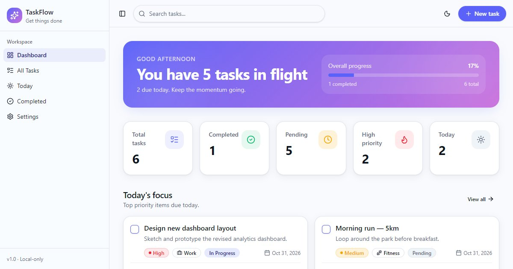

# TaskFlow

[](https://github.com/ramezGamel01/Task-Flow/actions/workflows/ci.yml)

A task manager for planning your day: add tasks with a due date, priority and category, then filter, sort and track your progress.

**Live:** https://task-flow-alpha-navy.vercel.app



## Features

- Dashboard with overall progress, totals (completed, pending, high priority, due today) and a "Today's focus" list
- Separate views for all tasks, tasks due today and completed tasks
- Create and edit tasks with a title, description, due date, priority (low, medium, high), category and status
- Filter by status, priority and category, sort the list, and search from the top bar
- Light and dark themes
- Everything is saved in the browser, so it works without an account; Settings can reset the data

## Stack

React 19, TanStack Start (file-based routing and server rendering), TypeScript, Tailwind CSS v4, shadcn/ui components and date-fns. Deployed on Vercel.

## Run locally

Requires Node.js 22 or newer.

```bash
npm install
npm run dev    # http://localhost:8080
```

## Project structure

```
src/routes/       pages: dashboard, all tasks, today, completed, settings
src/components/   sidebar, top bar, task cards, form, filters, stats
src/lib/          task types, sorting and filtering helpers, task and theme state
```
